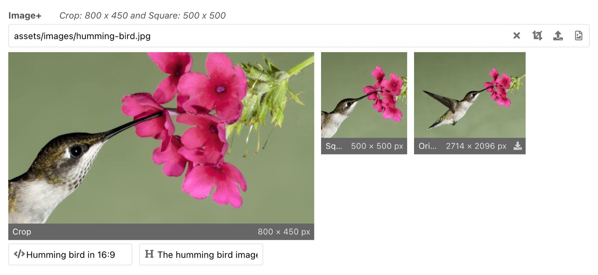
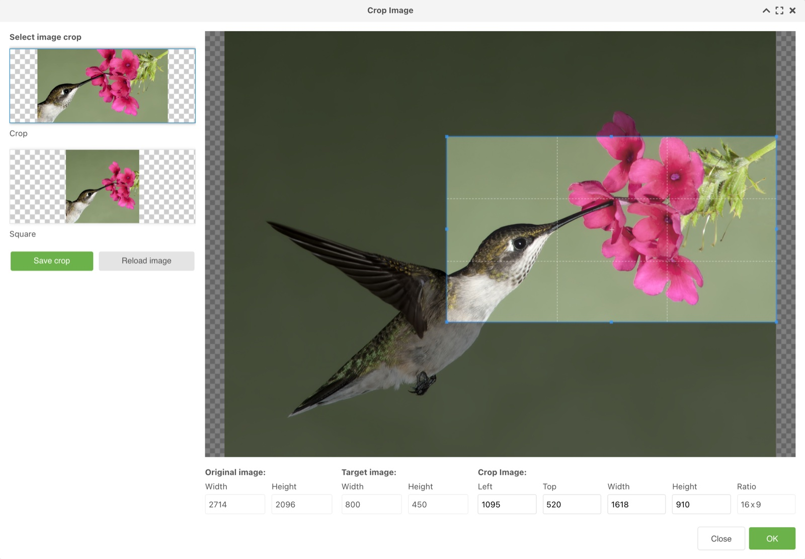

## Create a new template variable

Once Image+ is installed, you can create template variables [TV] in the usual
way, but instead of setting the **Input Type** in the Input Options to *Image*,
choose *Image+* instead.

For most use cases, you should also set the **Output Type** in the Output
Options to *Image+*. This allows you to control the image output on a resource.

## The template variable

The *Image+* TV contains a text field with the path of the image. You can also
type or paste the path of an image in the media source of the TV. The triggers
on the right side of the field (from left to right):

| Trigger | Description                                                                                     |
|---------|-------------------------------------------------------------------------------------------------|
| Clear   | Removes the image and its image crops from the TV.                                              |
| Crop    | Opens the cropping window with the first image crop.                                            |
| Upload  | Uploads an image from your computer into the media source and selects it [^1].                 |
| Browse  | Opens the media browser of the media source to select an image.                                 |

Below the field, the image crops are shown in the order of the **Image Crops**
input option, followed by the original image. Each preview has a bar with the
name and the size of the image. The bar of the original image contains a
download link. Click on a preview to open the cropping window with that image
crop (the original image opens the first image crop). If the TV is less than 700
pixels wide, only the first image crop is shown and the other images are shown,
when you hover over it. This compact display can be enabled permanently for
each TV by disabling the [Show All Images in One Line](usage.md#show-all-images-in-one-line)
input option.

The alt text, caption and credits fields are shown below the previews, if they
are enabled in the input options of the TV.

## The cropping tool

When using an *Image+* TV, you can select an image in the same way as you would
with a regular *Image* TV. Once an image is selected, a cropping window will
appear where you can select the area of the image to use. The original image is
not changed. So you can upload a single image and reuse it in multiple places on
the website at different sizes.

The image crops are saved as crop files in the media source. By default they are
saved in the `crop/` folder, which can be changed with the
[imageplus.crop_path](usage.md#contextsystem-settings) system setting. They get
the image format of the [Image Format](usage.md#image-format) input option of
the TV: WebP (the default), JPEG, PNG, GIF, AVIF or the format of the image.

You can also open the cropping window with the crop trigger (the crop icon) in
the image field of the Image+ TV.

In the cropping window you need to drag the handles of the box to change the
cropping area. If the TV has been configured with size constraints or an aspect
ratio, the cropping area will be limited to that aspect ratio.

You can also change the cropping area with the **Left**, **Top**, **Width** and
**Height** inputs in the *Crop Image* section below the image. The values are
pixels of the original image. A changed value moves or resizes the box, when the
input loses the focus or the value is changed with the arrows. A resized box
stays centered on its previous position. If the image crop has an aspect ratio,
a changed width changes the height too and vice versa. The fields of the
original image and the target image only show their sizes and are not editable.

If an image was replaced by a changed image with the same filename, click
**Reload image** in the cropping window. The image is loaded again and all saved
image crops are created again from it. If the size of the image has changed, the
cropping areas are scaled to the new size. If its aspect ratio has changed, you
should check the image crops and save them again. Save the MODX resource
afterwards.

[^1]: The image is uploaded into the path of the **Upload Path** input option, of the `imageplus.upload_path` system setting or into the root of the media source.
